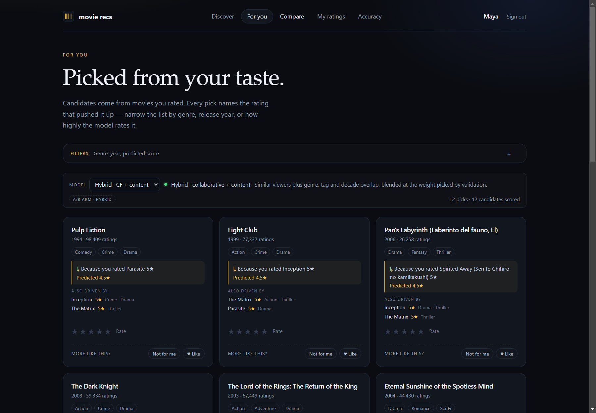
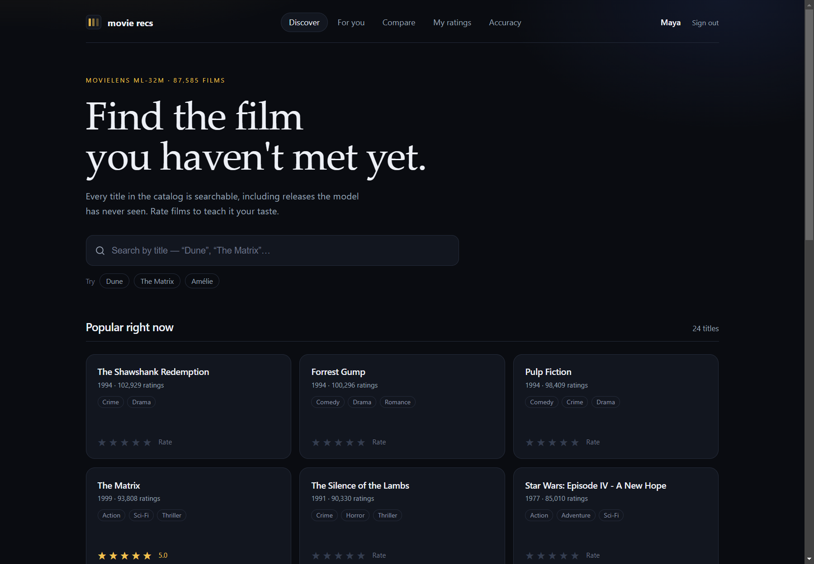
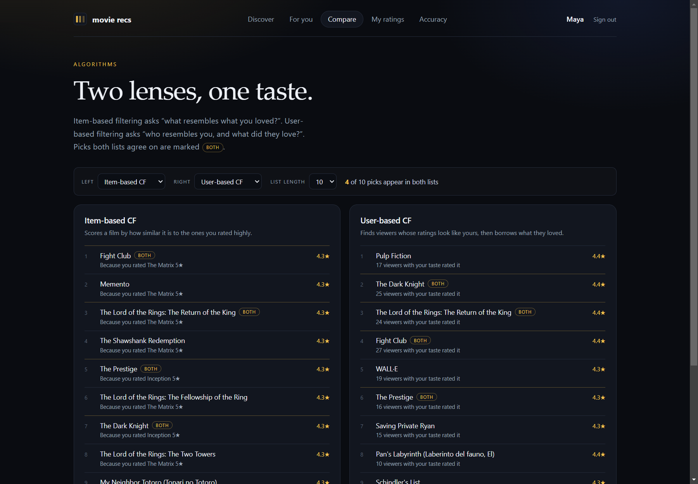
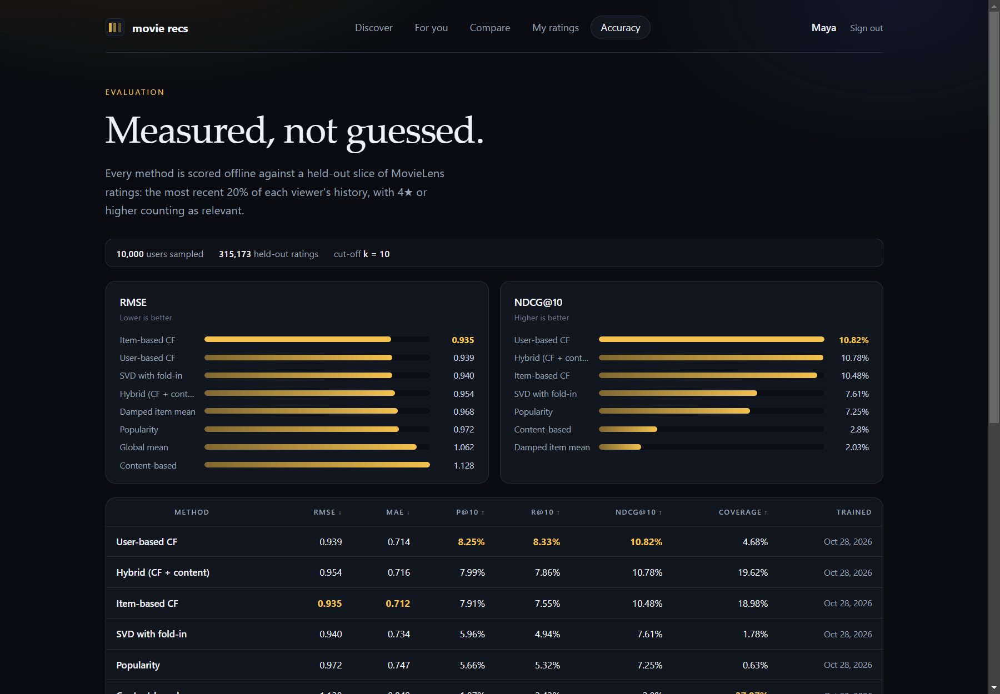
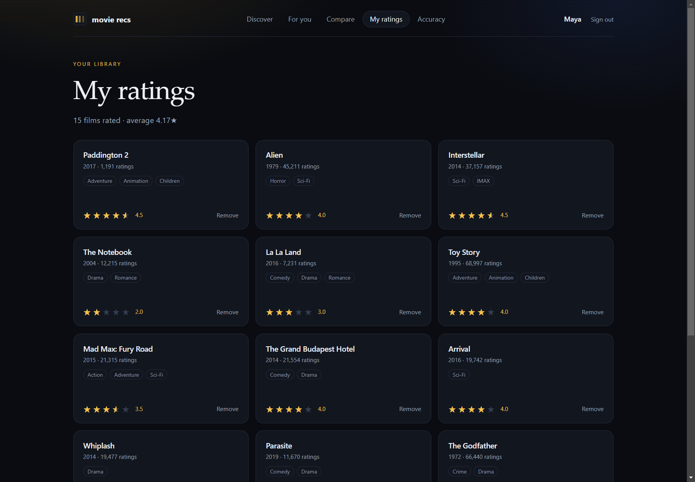
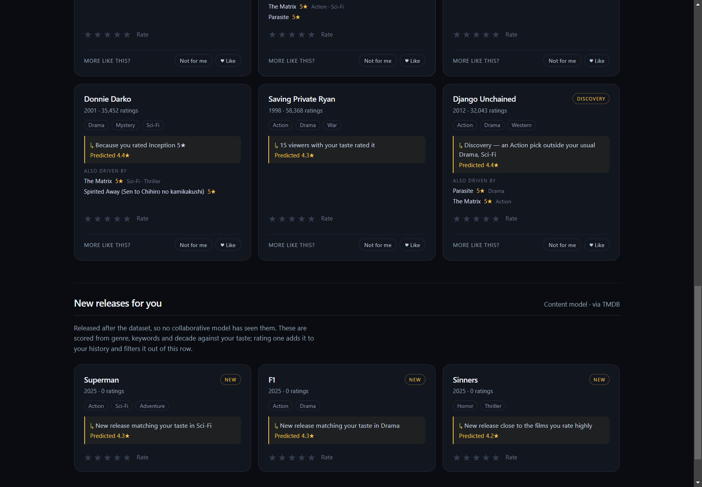

# Movie Recs

A full-stack movie recommender built on the MovieLens **ml-32m** dataset: 32 million ratings,
87,585 movies, and a catalog that stays searchable for every title — including movies too new or
too obscure for the model.

FastAPI + SQLAlchemy + Alembic backend, React + Vite frontend, and a pure-Python `recsys/` package
that holds all the data and ML logic (no web or database imports, so it can be tested alone).

**Current status:** every phase in [PLAN.md](PLAN.md) is implemented and tested, apart from the demo
recording (see [Known gaps](#known-gaps)). A
new user can sign up, rate five varied films on an onboarding screen, search the real catalog, rate
anything in half-star steps, and read personalized picks from five models — item-based CF, user-based
CF, SVD with fold-in, content-based, and the validation-tuned hybrid — each with the ratings behind
it. Which model a user gets **by default** is decided by a sticky A/B experiment; picking one by hand
overrides it. Lists can be filtered by genre, year and predicted score, back-of-list discovery picks
are labelled, and Like / Not for me feedback changes the next list immediately. Scored candidates are
cached per user (measured 1.65× faster on repeat requests) and the accuracy dashboard charts eight
methods plus live engagement per A/B arm. Posters and synopses appear automatically once a free TMDB
key is configured. Films released after the dataset are searched on TMDB, added to the catalog on
demand, rated like any other, and recommended by the content model in a “New releases for you” row.
The app ships as **one container** that serves the API and the React build from the same origin, with
the model artifacts fetched as a checksummed bundle at boot — see [Deploying it](#deploying-it).

## Screenshots

For you: the hybrid list, where every card names the rating that pushed it up and the runner-up
ratings behind it.



| Discover — search over all 87,585 titles | Compare — two methods for the same profile |
| --- | --- |
|  |  |

| Accuracy — the evaluated methods and costs | My ratings — the user's own library |
| --- | --- |
|  |  |

Films newer than the dataset, scored by content and labelled “New”. This capture comes from a local
run with three TMDB-era rows inserted by hand, because no live TMDB key is configured in this
checkout; with a key the row follows whatever TMDB currently lists.



## Quickstart

Prerequisites: [uv](https://docs.astral.sh/uv/) (installs Python 3.12 itself), Node 20+, and
optionally PostgreSQL 14+ with `pg_trgm`. SQLite works for local development.

```bash
uv sync

# 1. Raw MovieLens files -> Parquet, id maps, CSR matrix, chronological split (~16 s)
uv run python scripts/prepare_data.py

# 2. Train every artifact the API serves from: item neighbors, SVD, content features (~20 s)
uv run python scripts/train_and_precompute.py

# 3. Create the schema and load the catalog + 500 MovieLens demo users
uv run alembic upgrade head
uv run python scripts/seed_db.py

# 4. Run both servers
uv run uvicorn backend.app.main:app --reload --port 8000   # API + docs at /docs
cd frontend && npm install && npm run dev                  # UI on http://127.0.0.1:5173
```

Or run it the way a deployment does — one process, one origin, no dev proxy:

```bash
cd frontend && npm run build && cd ..
SERVE_FRONTEND=1 uv run uvicorn backend.app.main:app --port 8000   # UI and API on :8000
```

Copy `.env.example` to `.env` to point `DATABASE_URL` at PostgreSQL; the backend creates `pg_trgm` at
startup when it can and reports what it found. `pg_trgm` is an optimisation, not a requirement: on a
server that does not offer it (some builds ship without contrib, some managed databases forbid
`CREATE EXTENSION`) search still answers, ranked by word-start and popularity, and startup logs a
warning instead of failing. `JWT_SECRET` must be replaced in any deployment. `scripts/seed_db.py --demo-users 0` seeds the catalog only; `--refresh-demo` rebuilds
the demo users.

Optional, and what a deployment should schedule after each retrain: warm the recommendation cache
(`--users 0` warms every profile with ratings, `--clear` starts from scratch).

```bash
uv run python scripts/precompute_recs.py --users 200 --limit 50
```

## What you can do

| Feature | Notes |
| --- | --- |
| Sign up / sign in | JWT access tokens, bcrypt hashing, session restored from local storage |
| Search any movie | Word-start, then popularity, then trigram closeness; a misspelling is retried on PostgreSQL with word similarity ("matrx" finds *The Matrix*). All 87,585 titles |
| Rate films | Half-star widget (0.5–5.0), upsert and delete, "My ratings" library with the average |
| For you | Five models: hybrid, SVD with fold-in, item-based CF, user-based CF, content-based; the default is assigned by the A/B experiment and every pick carries a reason line, the runner-up ratings behind it and a damped predicted score |
| Filters | Genre chips, a release-year range and a minimum predicted rating, applied to a wider scored pool |
| Onboarding | Five well-known films spanning genres and decades; progress unlocks the personalised models, with popularity + genre fallback before that |
| Feedback | Like / Not for me on every pick; the action is logged and the film leaves the next list immediately |
| Discovery | A small tail slice is relabelled when it genuinely steps outside the profile, and badged “Discovery” |
| Compare | Any two of five methods side by side for the same profile, with picks both lists agree on marked “Both” |
| Accuracy | RMSE, MAE, precision/recall/NDCG@10 and coverage for eight methods, charted from `model_runs`, plus A/B engagement and the new-release row's share and like rate |
| A/B default model | Sticky per-user assignment between the hybrid and user-CF; the arm is shown on the page and its engagement is reported |
| Cached candidates | `precomputed_recs` holds scored candidates per user and method; repeat page loads skip the model, and stale rows are never served |
| Posters and details | Titles open a details dialog; posters and synopses load lazily from TMDB and cache locally |
| Search beyond the dataset | When the catalog returns fewer than five matches, TMDB is asked too; hits are labelled “Not in catalog” and can be added in one click |
| New releases | Films newer than MovieLens are scored by content (genres, keywords, decade), badged “New”, and shown in their own row; a small decaying freshness bonus re-ranks them |
| Cold start | Users with no usable signal get the popularity baseline plus an onboarding prompt |

The demo users (`password_hash="!"`, so they can never sign in) exist to give the catalog rating
history; recommendation serving never reads them at request time, since neighbors are precomputed.

## Dataset

Download **ml-32m** from <https://grouplens.org/datasets/movielens/> and extract it so that
`data/raw/ml-32m/ratings.csv` exists (about 228 MB zipped, 837 MB for `ratings.csv`).

| File | Rows (verified) |
| --- | --- |
| `ratings.csv` | 32,000,204 ratings from 200,948 users |
| `movies.csv` | 87,585 movies |
| `links.csv` | 87,585 rows (IMDb + TMDB ids) |
| `tags.csv` | 2,000,072 free-text tags |

Verified on this checkout: 200,948 distinct users, 84,432 movies with at least one rating, and
5,357 catalog titles released in 2021 or later (e.g. *Dune* 2021, *Everything Everywhere All at
Once* 2022, *The Matrix Resurrections* 2021).

`data/raw/` is **read-only**: nothing in the pipeline writes to it, and neither raw nor processed
data is committed. The newest release in ml-32m is from 2023, so a film released after that appears
through the on-demand TMDB ingestion described in
[Films newer than the dataset](#films-newer-than-the-dataset-510513) — and never through the
collaborative models, which have no ratings to learn from for it.

## The pipeline

### 1. `scripts/prepare_data.py` — raw files to model inputs

Defaults follow `PLAN.md`: movies with **at least 20 ratings**, users with at least 20 ratings, a
development sample of **20,000 users / ~3M ratings** (seed 42), and a **chronological per-user 80/20
split**. Output in `data/processed/`:

| Artifact | Contents |
| --- | --- |
| `catalog.parquet` | Every movie: normalized titles, year, genres, IMDb/TMDB ids, rating count/mean, `in_model` |
| `ratings_sample.parquet` | Filtered ratings for the sampled users |
| `ratings_train.parquet`, `ratings_test.parquet` | Chronological split, with `user_index`/`movie_index` |
| `user_id_map.parquet`, `movie_id_map.parquet` | Raw ids ↔ compact integers |
| `train_matrix.npz` | SciPy CSR users × movies matrix (training rows only) |
| `manifest.json` | Filters, sample sizes, rating histogram, sparsity, memory, timings |

Default run on the full ml-32m file (15.8 s):

```
23,350 movies with >= 20 ratings; sampled 18,632 users (3M-rating budget)
Sample:  2,974,026 ratings, 18,632 users, 22,973 movies
Split:   2,386,395 train / 587,631 test
Matrix:  18,632 x 22,973, nnz=2,386,395, density=0.5575%, 18.28 MB
Catalog: 87,585 movies, 22,973 marked in_model
```

Useful flags: `--max-users 0 --max-ratings 0` (no sampling; needs more RAM),
`--chunk-size 1000000`, `--min-item-ratings`, `--test-fraction`, `--seed`.

### 2. `scripts/train_and_precompute.py` — every serving artifact

One pass builds every artifact serving reads, each written next to a JSON sidecar recording its
parameters, size and training time:

| Artifact | What it is | Verified run |
| --- | --- | --- |
| `item_neighbors.npz` | Top-50 cosine neighbors on the mean-centered matrix, in bounded blocks (a dense item × item matrix is never materialized) | 22,013 of 22,973 items, 2.39M nnz, 5.5 MB, 14.7 s |
| `svd_model.npz` | Biased SVD, rank 50, `svds` on the residual matrix, plus item factors for fold-in | train RMSE 0.8158, 7.8 MB, 1.3 s |
| `content_features.npz` | Weighted, L2-normalised genre, decade and top-tag features over **all 87,585 catalogue films**, not just the model universe | 334 features (19 genres, 15 decades, 300 tags), 0.6 MB |

User-based CF needs no separate artifact: `UserCfService` folds the signed-in user into
`train_matrix.npz` (from step 1) at request time, which is why it works for accounts that have no
training row. `user_neighbors.npz` is an **evaluation** artifact, built by step 3 when missing, and
is never read while serving.

Useful flags: `--rank`, `--bias-regularisation`, `--factor-regularisation`, `--k`, `--block-size`,
`--tag-top`, `--no-svd`, `--no-content`, `--include-app-ratings`, `--min-item-ratings`, `--sync-db`.

#### Merging the app's own ratings (5.11)

A film ingested from TMDB has no MovieLens ratings, so no collaborative model can see it however
much the app's users rate it. `--include-app-ratings` folds the application's ratings into the
training matrix before the artifacts are built, and a film joins the model once its catalogue rating
count plus its app ratings reach `--min-item-ratings` (default 20):

```bash
uv run python scripts/train_and_precompute.py --include-app-ratings --sync-db

# App ratings: 45 from real accounts
#   merged 44 ratings from 10 accounts; 0 duplicate pairs dropped
#   0 films promoted to the model, 1 still below 20 ratings
#   marked 0 films in_model in the database
```

(`recsys/augment.py`; tests in `tests/test_augment.py` and `backend/tests/test_retrain_merge.py`.)

Three details make it safe to run on a schedule:

- **App users are new rows, never MovieLens ids.** A database user id means nothing to MovieLens, so
  merging one as-is would attribute a stranger's ratings to a real profile; they are written as
  `userId + 10,000,000` instead.
- **A re-run replaces the previous merge**, because the id maps record which rows and columns the
  merge added. Running it daily cannot double a rating or invent a duplicate account.
- **Films below the threshold keep their ratings in the database**, stay recommendable through the
  content model, and are listed in `app_merge.json` rather than silently dropped. `--sync-db` marks
  promoted films as `in_model` in the catalogue; without it the artifacts and the badge disagree.

Seeded MovieLens demo profiles are excluded: their ratings are already training data, and counting a
mirrored profile twice would make it look like two people share its taste.

### 3. `scripts/evaluate_models.py` — the head-to-head numbers

Scores eight methods on the same held-out pairs, tunes the hybrid weight on a validation slice of
the *training* data (never the test slice), and writes `data/processed/evaluation.json` plus one
row per method in the `model_runs` table. It also builds and caches `user_neighbors.npz` (k=50) the
first time, for the offline user-CF comparison. See [Results](#results).

`--import-only` skips the evaluation entirely and refreshes `model_runs` from the saved report
instead. A deploy ships that report as an artifact but starts on a database that has never run the
evaluation, so without this step the accuracy dashboard would be empty; the import is what makes the
shipped numbers appear, and it replaces rows per algorithm so a restart cannot duplicate them.

### 4. `scripts/precompute_recs.py` — candidate cache

Turns the artifacts into per-user candidate rows so a signed-in user's second page load does not run
a model. Only profiles with at least one rating are warmed (seeded MovieLens users are skipped: they
cannot sign in), most recently active first:

```
warmed 5/5 profiles in 0.5s (limit=20)
  hybrid       80 candidates across 4 profiles
  svd         100 candidates across 5 profiles
  item_cf      80 candidates across 4 profiles
  user_cf      80 candidates across 4 profiles
  content     100 candidates across 5 profiles
```

Two profiles has no candidates for the collaborative models: their ratings leave nothing after
mean-centering, so those models correctly fall back to popularity, which is never cached.

### 5. `scripts/seed_db.py` — catalog and demo users

The database stores the **catalog** (all 87,585 movies) and **demo users** only; the 32M training
ratings stay on disk as Parquet and a CSR matrix.

```
movies: 87,585 (22,973 in_model) · users: 500 demo · ratings in DB: 63,049
```

## How recommendations work

`backend/app/recommendations.py` loads the precomputed neighbors once and folds the signed-in user's
ratings in at request time, so **no similarity is ever computed on a request**:

1. Ratings for movies inside the model universe are mapped to their compact indexes.
2. `recsys.item_cf.recommend_from_ratings` scores candidates as
   `Σ similarity × (rating − user mean)` over the user's rated items — sparse, so only co-rated
   items contribute, and missing ratings are never treated as zeros.
3. Scores are turned into a predicted rating by shrinking toward the user's mean with `damping=4.0`
   and clamping to 0.5–5.0, so a couple of neighbors cannot push every pick to 5.0.
4. Movies the user already rated are always excluded; candidates need positive evidence, so rating
   something 1★ never *causes* a recommendation.
5. The reason line names the rated movie with the strongest positive contribution
   ("Because you rated The Godfather 5★"); the response also carries the next two contributors with
   their ratings and shared genres, which the card shows as "Also driven by".

User-based CF is served the same way from a precomputed user-neighbor table: the live user's vector
is folded in at request time (`recsys.user_cf.recommend_for_folded_user`), and the profile's own
rated items are excluded inside the function so a caller cannot forget.

Four further models load their artifacts once and answer from them:

- **SVD with fold-in** (`recsys.svd`): the trained item factors are fixed; a ridge least-squares
  fold-in turns the live user's ratings into a user vector in milliseconds, so a brand-new profile
  gets latent-factor picks without a retrain.
- **Content-based** (`recsys.content`): weighted genre, decade and tag features (1.0 / 0.55 / 0.35,
  L2-normalised) for **all 87,585 catalogue films**, including titles with a handful of ratings that
  the collaborative models cannot see. A user profile is the features of their films weighted by how
  far each rating sits above their own mean (falling back to "above 3★" when there is no spread),
  then scored by cosine similarity, with a conservative slope mapping similarity into rating space so
  a content score never pretends to be a calibrated prediction.
- **Hybrid** (`recsys.hybrid`): the collaborative list and the content list are each normalised on
  their own scale, then blended at the weight chosen on a validation slice (`hybrid_weights.json`).
  The collaborative base and weight are data, not code, so re-tuning needs no deploy.
- **Serendipity** (`recsys.serendipity`): once a profile is real, a small tail slice is relabelled as
  discovery when it steps outside the user's favourite genres, so the card carries a “Discovery”
  badge and a line naming the genre it breaks away from.

Serving stays artifact-only — no similarity or factor is computed on a request. If a content or SVD
artifact is missing, that model answers with a 503 (`ArtifactsUnavailable`) instead of quietly
substituting something else, and the hybrid deliberately falls back to its collaborative base.

When nothing survives mean-centering (no ratings, one rating, or ratings that all equal the user's
mean), the service falls back to the popularity baseline and reports `cold_start=true`, which is
what the UI uses to show the onboarding prompt instead of the personalization copy. A profile with
fewer than five ratings reports `needs_onboarding=true` and is pointed at the five-film onboarding
screen, which deliberately spans genres and decades so the first profile is not a monoculture.

## A/B experiments and the candidate cache

### Which model a user sees by default (5.8)

`backend/app/experiments.py` runs one experiment, `default_model_v1`, splitting users between the
tuned `hybrid` and `user_cf`, the best-ranking single model. Three decisions make the numbers
defensible:

- **Assignment is sticky and reproducible.** The arm is a SHA-256 bucket of `(experiment, user_id)`,
  written to `experiment_assignments` on first sight. The hash keeps the split even without storage;
  the row means a user never moves arms and a later change to the variant list cannot reshuffle
  people who are already in.
- **Only assigned traffic counts.** `GET /api/recommend` consults the experiment only when the client
  omits `algorithm`. A user who picks a model in the UI sends it explicitly, that impression is
  logged with a null arm, and it never enters the comparison.
- **Outcomes are attributed in time.** A like, reject, click or rating counts for an arm only when it
  happened **at or after** the impression of that film; a rating from before the recommendation
  cannot flatter whichever arm happened to show the film afterwards.

`GET /api/experiments` returns, per arm: assigned users, impressions, likes, rejects, clicks,
impressions later rated, like rate (likes ÷ like-or-reject verdicts) and rated rate. The accuracy
page renders it as **Live engagement**, and it refuses to call a leader below 50 impressions per arm
— with traffic this young the honest answer is a tally, not a result.

### Cached candidates (5.9)

The cache stores **scored candidates**, not rendered cards. A hit still resolves movie rows, applies
current exclusions and filters, and rebuilds the reason lines; what it skips is the neighbour and
factor maths. That ordering is deliberate: a cached list cannot resurrect a film the user rated
since, and cannot show a stale explanation.

| Rule | Behaviour |
| --- | --- |
| Filters | Never served from cache — a filtered list needs a wider pool than the warm one |
| Warm pool too small | Falls back to the model and rewrites the cache |
| Exclusions | Applied live; if they empty the pool the list is recomputed rather than shortened |
| Retrain | Rows older than the newest artifact file are ignored |
| Age | Rows older than `PRECOMPUTE_TTL_MINUTES` (default 360) are ignored |
| Write failures | Logged and swallowed: a broken cache is a slow request, never a failed one |

Measured on the local database and the real artifacts, 15 alternating request pairs as user `Mira`
(arm `user_cf`, limit 12), with the cache cleared before each pair:

| Path | Median | Min |
| --- | --- | --- |
| Live (`cached: false`) | 14.39 ms | 13.72 ms |
| Cached (`cached: true`) | 8.74 ms | 7.64 ms |

**1.65× on the median**, identical picks in both cases. The remaining 8.7 ms is database work the
cache does not remove — loading the profile, exclusions, candidate movie rows and writing
impressions — which is why the estimate stays modest instead of claiming an order of magnitude. The
serve path reports `cached` so the claim is checkable per request instead of inferred.

## Posters and details

The catalog already carries `tmdbId` from `links.csv`, so a poster is a join, not a second source of
truth. Without a key the app degrades cleanly: cards render text-only, the details dialog says the
synopsis is not in the catalog yet, and nothing fails.

1. Request a free key from [TMDB](https://www.themoviedb.org/settings/api) (a v4 read access token is
   preferred; a v3 API key also works).
2. Put `TMDB_READ_ACCESS_TOKEN=…` or `TMDB_API_KEY=…` in `.env`.
3. Optionally warm the cache: `uv run python scripts/fetch_posters.py --limit 500`. The script
   visits the most-rated films by default and has `--limit`, `--min-rating-count` and `--dry-run`.

Requests are server-side only, throttled to 20/s, retried once on a 429 with `Retry-After`, cached
as JSON under `data/processed/tmdb_cache/`, and written back to the movie row after the first
successful lookup. Every failure path returns `None`, so a TMDB outage cannot break search or
recommendations. TMDB's terms require the attribution in the footer:

> This product uses the TMDB API but is not endorsed or certified by TMDB.

A deployment should also show the TMDB logo per their brand guidelines; local development shows the
text notice.

## Films newer than the dataset (5.10–5.13)

MovieLens ml-32m stops in 2023. Anything released after that can still be found, added, rated and
recommended — without pretending the collaborative models have ever seen it.

**Search finds them.** `GET /api/movies/search` ranks the catalog first. When the catalog returns
fewer than five matches, the backend also asks TMDB's `/search/movie` and returns those hits in a
separate `external` list with `external_source: "tmdb"`. A hit whose `tmdbId` is already in the
catalog is suppressed, so the same film is never offered twice. With five or more local hits TMDB is
not called at all, which keeps a plain “matrix” search at one round trip. External results are never
written to the database: browsing cannot bloat the catalog.

**Opening or rating one adds it.** `GET /api/movies/tmdb/{tmdbId}` is the only write path, and it is
idempotent:

- the row gets `id = 10,000,000 + tmdbId`, above every MovieLens id, so a new film can never collide
  with an old one;
- matching is on `tmdbId` first, then IMDb id — a MovieLens film that links to the same film is
  reused (and its missing `tmdb_id` filled in) instead of being duplicated;
- genres are mapped onto MovieLens labels (`Science Fiction` → `Sci-Fi`), keywords are stored
  lower-cased, and the row records `source = "tmdb"`, `in_model = false`, `rating_count = 0` — TMDB
  vote counts are not MovieLens ratings and are never mixed into popularity ordering;
- a 404 from TMDB is cached (the id does not exist); a 500, a timeout or a rate limit is not, so a
  blip is retried next time.

**They are recommended by content.** A film with no ratings is invisible to item-CF, user-CF and SVD.
`GET /api/recommend/new-releases` scores the TMDB-era catalog against the same taste profile the
content model builds from a user's ratings, using the feature vocabulary frozen at training time — a
new genre or keyword is ignored rather than shifting every other row. The row is honest about it: a
user with no positive content signal sees “New in the catalog — no personal taste signal yet” rather
than a fabricated match.

**Freshness is a dial, not a secret.** Re-ranking adds `w · exp(−age_in_days / 365)` for films inside
the window, with `NEW_RELEASE_YEARS` (default 2) and `NEW_RELEASE_BOOST` (default 0.15) in the
environment. The bonus changes the order only; the reported score is still the model's own number.
On this catalog its effect is close to zero by construction, because the dataset ends in 2023, and
its real home is films ingested from TMDB afterwards. That is stated instead of being sold as a
measured win.

The whole path is tested against mocked TMDB transports: no test makes a live call, and a missing
key, a 429, a 500 and a 404 are all ordinary cases.

**The row is measured, not assumed.** Showing it records one impression per card with
`algorithm = "new_releases"`, and `GET /api/new-releases/report` folds those into the numbers PLAN
5.12 asks for: the row's share of everything served, how many films and users it reaches, and the
like and rated-after rates, counting only outcomes that happened at or after the impression. The
accuracy page renders it under **New releases**, and refuses to read a rate as a result below 50
impressions. On a fresh database it shows the honest empty state instead of zeroes.

## Results

Protocol (`PLAN.md` §9): the **chronological per-user split**, most recent 20% held out; a sample of
**10,000 users** (seed 42) out of the 18,632 in the model universe; **315,173 held-out ratings**;
ranking at **k=10** with a held-out rating of **4.0 or higher** counted as relevant. Every method is
scored on the same pairs; users with no relevant held-out item (234 of the sample) are reported as
skipped rather than scored as zero. Run on 2026-10-28 with `uv run python scripts/evaluate_models.py`.

| Method | RMSE | MAE | P@10 | R@10 | NDCG@10 | Catalogue coverage |
| --- | --- | --- | --- | --- | --- | --- |
| `global_mean` | 1.0625 | 0.8310 | — | — | — | — |
| `damped_item_mean` | 0.9681 | 0.7434 | 0.0183 | 0.0168 | 0.0203 | 0.17% |
| `popularity` | 0.9721 | 0.7466 | 0.0566 | 0.0532 | 0.0725 | 0.63% |
| `item_cf` | **0.9354** | **0.7120** | 0.0791 | 0.0755 | 0.1048 | 18.98% |
| `user_cf` | 0.9395 | 0.7137 | 0.0825 | 0.0833 | **0.1082** | 4.68% |
| `svd` | 0.9396 | 0.7336 | 0.0596 | 0.0494 | 0.0761 | 1.78% |
| `content` | 1.1277 | 0.8489 | 0.0187 | 0.0243 | 0.0280 | **37.97%** |
| `hybrid` | 0.9539 | 0.7157 | 0.0799 | 0.0786 | 0.1078 | 19.62% |

Sample: 9,766 evaluated users per ranking row. Cost, same run:

| Method | Pairs on the item-mean fallback | Evaluation time | Peak traced memory |
| --- | --- | --- | --- |
| `global_mean` | — | 0.3 s | 92 MB |
| `damped_item_mean` | — | 1.8 s | 9 MB |
| `popularity` | — | 1.7 s | 8 MB |
| `item_cf` | 26.99% | 5.3 s | 304 MB |
| `user_cf` | 24.41% | 5.2 s | 294 MB |
| `svd` | 0.00% | 4.0 s | 276 MB |
| `content` | 0.00% | 9.9 s | 369 MB |
| `hybrid` | 0.00% | 43.6 s | 848 MB |

Artifact training: item neighbors 14.7 s (5.5 MB), SVD 1.3 s (7.8 MB), content features 0.6 MB over
87,585 films. The whole evaluation is a 72 s job on a development subset, which is what makes
iterating on models cheap; the hybrid is slowest because it scores two candidate lists per user.

**Hybrid tuning** (`evaluation.json` → `tuning`): the weight was chosen on a **validation slice of the
training ratings** (3,000 users, most recent 15% of train), never on test. Both candidate bases were
swept from 0.0 to 1.0 in 0.1 steps: user-CF peaks at a collaborative weight of **0.7** (NDCG@10
0.1290 on validation, against 0.1250 at weight 1.0), item-CF at 0.7 as well (0.0927). So on the
tuning data the content blend earns its place; on the test slice it does not, and that is reported
below rather than hidden.

What the numbers say:

- **The sanity checks in the plan hold.** Damped item mean beats the global mean (0.9681 vs 1.0625
  RMSE), item-CF beats the item mean (0.9354), and every learned model beats plain popularity on
  NDCG except content.
- **Ratings and ranking disagree about the best method.** User-CF ranks best (NDCG@10 0.1082) while
  item-CF predicts best (RMSE 0.9354). The hybrid lands between them (0.1078) — **it matches, but
  does not beat, the best single model on this test slice**, a 0.4% gap, while covering four times
  as much of the catalogue as user-CF (19.62% vs 4.68%). Phase 5's acceptance line asks the hybrid
  to match or beat the best single model; on validation it clearly does, on test it only matches.
- **SVD is the weakest learned ranker** (NDCG@10 0.0761) despite respectable RMSE (0.9396). Rank-50
  factors compress taste well enough to predict a rating but not well enough to separate the top
  ten, which is the classic reason production systems rank with CF and predict with factors.
- **Content is the only model that covers the long tail.** It is last on accuracy (1.1277 RMSE) and
  first on catalogue coverage by a wide margin (37.97%), because its features exist for all 87,585
  films, not just the 22,973 in the model universe. That is the job it was built for: making films
  outside the trained universe recommendable at all.
- **Popularity is a strong ranking baseline** — better than the damped item mean (NDCG@10 0.0725 vs
  0.0203) — but it recommends almost the same 145 films to everyone (0.63% catalogue coverage),
  while item-CF covers 18.98%. That is the popularity bias the plan warns about, now measured.
- **Collaborative methods need support to say anything.** 26.99% of held-out pairs have no neighbor
  evidence for item-CF (24.41% for user-CF); those pairs fall back to the damped item mean and are
  reported rather than hidden, so part of item-CF's RMSE win is the baseline it borrows. SVD,
  content and the hybrid score every pair (0.00%), which is why their RMSE is more directly
  comparable with each other than with the neighbor models.

## API

| Method | Path | Auth | Notes |
| --- | --- | --- | --- |
| `GET` | `/api/health` | – | App + database status |
| `POST` | `/api/auth/signup` | – | Returns the user and an access token |
| `POST` | `/api/auth/login` | – | Same shape as signup |
| `GET` | `/api/auth/me` | ✔ | Current user profile |
| `GET` | `/api/movies/search?q=&limit=&include_external=` | – | Ranked by match tier, then rating count; `external` holds addable TMDB hits when the catalog has fewer than five matches |
| `GET` | `/api/movies/genres` | – | Every genre label in the catalog, for the filter chips |
| `GET` | `/api/movies/{id}` | – | Catalog detail, enriched from TMDB once when a key is set |
| `GET` | `/api/movies/tmdb/{tmdb_id}` | – | Adds a film TMDB knows to the catalog once and returns it; 503 without a key, 404 when TMDB cannot supply it |
| `GET` | `/api/ratings` | ✔ | The user's ratings with movie payloads |
| `POST` | `/api/ratings` | ✔ | Upsert; rejects non-half-star values and out-of-range ratings |
| `DELETE` | `/api/ratings/{movie_id}` | ✔ | 204 on success, 404 when unrated |
| `GET` | `/api/recommend?limit=&algorithm=&experiment=&genres=&year_min=&year_max=&min_score=` | ✔ | Picks with score, predicted rating, reason, evidence, `discovery` and `cached` flags. Omit `algorithm` and the A/B experiment assigns `hybrid` or `user_cf` (reported as `experiment`/`variant`); pass it to choose `hybrid`, `svd`, `item_cf`, `user_cf` or `content` |
| `GET` | `/api/recommend/new-releases?limit=` | ✔ | Films newer than the dataset, scored by content only, with a `new_release` badge; empty when nothing in the catalog is recent. Impressions are logged as `new_releases` |
| `GET` | `/api/compare?limit=&left=&right=` | ✔ | Any two of the five algorithms for one profile, with `overlap` ids and `overlap_count` |
| `GET` | `/api/onboarding` | ✔ | Five diverse, well-known films plus the user's rated count |
| `GET` | `/api/feedback` | ✔ | The user's liked / rejected / clicked history, newest first |
| `POST` | `/api/feedback` | ✔ | Record `liked`, `rejected` or `clicked` with the algorithm that showed the pick |
| `DELETE` | `/api/feedback/{movie_id}` | ✔ | Undo feedback for a film |
| `GET` | `/api/model-runs?limit=` | – | Latest evaluation per method, newest first |
| `GET` | `/api/experiments` | – | Every A/B experiment with per-arm users, impressions, likes, rejects, clicks and the rates derived from them |
| `GET` | `/api/new-releases/report` | – | The recency row's impressions, share of all impressions, films, likes, rejects, clicks and the rates derived from them |

## Deploying it

The repository holds code; it deliberately holds no data. A deployment is four pieces:

| Piece | Source |
| --- | --- |
| API + React build | one Docker image, built by [`Dockerfile`](Dockerfile) |
| Catalog and model artifacts | a checksummed `artifacts.tar.gz`, built by [`scripts/build_artifact_bundle.py`](scripts/build_artifact_bundle.py) and fetched at boot |
| Users, ratings, feedback, impressions, `model_runs` | PostgreSQL |
| The 32M training ratings | nowhere — they never leave the machine that trains |

```
                 ┌──────────────────────────── browser ─────────────────────────────┐
                 │   React + Vite build, served by FastAPI itself (one origin)       │
                 └───────────────┬──────────────────────────────────────────────────┘
                                 │  /api/*
                 ┌───────────────▼───────────────────────────────────────────────┐
                 │  FastAPI: auth · search · ratings · recommend · compare       │
                 │           feedback · experiments (A/B) · precompute cache    │
                 └───────┬───────────────────────────────┬───────────────────────┘
                         │                               │
        ┌────────────────▼──────────┐      ┌─────────────▼──────────────────────┐
        │ PostgreSQL (+ pg_trgm)    │      │ data/processed — read-only at serve│
        │ users · ratings · movies  │      │ item_neighbors.npz · svd_model.npz │
        │ feedback · logs           │      │ content_features.npz · train_matrix│
        │ model_runs · assignments  │      │ catalog.parquet · hybrid_weights   │
        └───────────────────────────┘      └─────────────▲──────────────────────┘
                                                         │ publish, then fetch + verify
   offline, on a laptop (16 GB)                          │
   ml-32m ──► prepare_data ──► train_and_precompute ──────┘
                    │                  └──► evaluate_models ──► model_runs, evaluation.json
                    └──► seed_db (catalog + demo users)     precompute_recs (needs the live DB)
```

### One container, one origin

With `SERVE_FRONTEND=1` the API serves `frontend/dist` at `/`: `/assets` is mounted as static files,
`/` and any unknown page return `index.html` so a reload of a client-side view works, and a path under
`/api/` still answers JSON — an unknown API route is a 404, never the SPA shell. The frontend calls
`/api` relatively, exactly as it does behind the Vite dev proxy, so production needs no CORS rules and
no second service. Without a build present the app logs a warning and serves the API alone, which is
why the flag is off in development and in the test suite.

The image is two stages: Node builds the SPA, then a slim Python image installs the locked
dependencies with `uv sync --frozen`, copies the app, and runs as an unprivileged user. Its
`HEALTHCHECK` polls `/api/health`, the same path the host is told to probe.

### Artifacts, not a data bake

Serving cannot work without `data/processed/`, but baking ~26 MB of Parquet and sparse matrices into
every image would rebuild the image on every retrain. The bundle is therefore published once and
downloaded at boot:

```bash
uv run python scripts/train_and_precompute.py     # the serving artifacts
uv run python scripts/build_artifact_bundle.py    # -> dist/artifacts.tar.gz + .sha256

# Wrote dist/artifacts.tar.gz (26.5 MB)
#   8 artifacts, 62.4 MB before compression
#   sha256 <digest>
```

Publish the archive anywhere public (a GitHub release asset, R2, S3) and set `ARTIFACTS_URL` and
`ARTIFACTS_SHA256`. [`scripts/fetch_artifacts.py`](scripts/fetch_artifacts.py) downloads into a
staging directory, checks the digest **before** unpacking, accepts only flat regular files that the
archive's own manifest lists (so a tampered bundle cannot write outside `data/processed/`), and
leaves nothing half-written on failure. When every required artifact is already on disk it exits
immediately, which is what makes a restart cheap.

### First boot, in order

[`scripts/start.sh`](scripts/start.sh) is idempotent, because a hosted container restarts often:

1. fetch the artifacts if they are missing (verifying them when it does);
2. `alembic upgrade head`, so the schema is always the code's schema;
3. seed the catalog once when `SEED_ON_START=1` — `--skip-if-seeded` means a long-lived database is
   never rewritten on every boot — and mirror `DEMO_USERS` MovieLens profiles;
4. import `evaluation.json` into `model_runs` when it is present (`IMPORT_EVALUATION=1`), so the
   accuracy page shows the measured numbers on a database that never ran the evaluation. A missing
   report is a warning, never a failed boot;
5. start `uvicorn --proxy-headers` with one worker.

### Environment

| Variable | Default | Purpose |
| --- | --- | --- |
| `DATABASE_URL` | `sqlite:///./movie_recs.db` | PostgreSQL in production. A host-issued `postgres://…` URL is rewritten to the installed `psycopg` driver, so the connection string works as handed over |
| `JWT_SECRET` | dev placeholder | Token signing key; must be replaced |
| `SERVE_FRONTEND` | `0` | Serve the built SPA from the API origin |
| `FRONTEND_DIST` | `frontend/dist` | Where that build lives |
| `ARTIFACTS_URL`, `ARTIFACTS_SHA256` | unset | Bundle to fetch at boot |
| `PROCESSED_DIR` | `data/processed` | Where artifacts are read from |
| `SEED_ON_START`, `DEMO_USERS` | `0`, `500` | One-time catalog seeding at boot |
| `IMPORT_EVALUATION` | `1` | Fill `model_runs` from the shipped `evaluation.json` at boot |
| `TMDB_READ_ACCESS_TOKEN` / `TMDB_API_KEY` | unset | Posters, synopses, search beyond the dataset, on-demand ingestion |
| `PRECOMPUTE_TTL_MINUTES` | `360` | Cached candidates older than this are ignored |
| `NEW_RELEASE_YEARS`, `NEW_RELEASE_BOOST` | `2`, `0.15` | Recency window and re-ranking bonus |
| `CORS_ORIGINS` | `localhost:5173` | Only needed when the UI is served separately |

[`.env.example`](.env.example) lists them all with the local defaults.

### Render

[`render.yaml`](render.yaml) is a blueprint for a free web service plus a free PostgreSQL instance:

1. Push the repository and choose **New → Blueprint** in Render, pointing at the repo.
2. Build the bundle locally, publish it, and set `ARTIFACTS_URL` and `ARTIFACTS_SHA256` on the service
   (both are `sync: false`, so they are entered once and never committed).
3. Add `TMDB_READ_ACCESS_TOKEN` only if posters and on-demand films are wanted. The database URL, a
   generated `JWT_SECRET`, `SERVE_FRONTEND` and `SEED_ON_START` all come from the blueprint.

A free instance is a demo host, not a benchmark: it sleeps when idle (the first request afterwards
pays the artifact load), its database is small and time-limited, and the blueprint pins **one worker**
because the artifacts live in process memory. Training the full 32M-rating dataset is a laptop job
(`PLAN.md` §3); a deployment only ever carries the processed subset and the artifacts above.

### What was verified here, and what was not

Verified on this checkout:

- the production build served by FastAPI on a single port: `/` and `/recommendations` return the SPA,
  `/assets/*` the bundles, `/api/health` JSON, `/api/does-not-exist` a JSON 404;
- `scripts/start.sh` end to end against a database on disk: artifact check, migrations, one-time seed
  that skips on the second boot, uvicorn, healthy `/api/health`;
- the bundle built at 26.5 MB, served over HTTP, fetched with a matching checksum, and a corrupted
  download rejected before extraction;
- the exact commands the image runs, executed outside the image.
- **the PostgreSQL path, end to end, on two real servers**, with a script in the repo:
  [`scripts/verify_postgres.py`](scripts/verify_postgres.py) migrates up → down → up again, seeds
  the 87,585-row catalog twice, imports the evaluation report, then drives signup, search, rating,
  recommendations, filters, comparison, `model_runs`, the new-release report and the auth boundary
  against the live server. Run on PostgreSQL 16.2 with `pg_trgm` (**28/28**) and on 16.2 without
  contrib, the fallback path (**27/27**).

  ```bash
  uv run --with pgserver python scripts/verify_postgres.py --bundled   # no setup, no contrib
  uv run python scripts/verify_postgres.py --database-url postgresql://…/scratch
  ```

  That run is what caught the three defects fixed here: search needed `pg_trgm` unconditionally,
  a misspelling matched nothing, and an exact trigram match could outrank the film everyone means.
  It also measured the search path: 8–14 ms on 87,585 titles, including the typo fallback.

Not verified, and stated as such: **no `docker build`** (Docker is not installed on this Windows
machine), **no live Render deployment**, and **no managed database** — connection pooling, a
host-issued SSL URL and a free tier's sleep/wake cycle have not run here. The extension probe is
exactly what a managed database needs, because `CREATE EXTENSION` is not always permitted there.

## Tests and lint

```bash
uv run pytest        # 380 tests: titles, pipeline, metrics, baselines, item/user CF, SVD fold-in,
                     #            content, hybrid, serendipity, evaluation, API, onboarding,
                     #            feedback, A/B assignment and attribution, cache validity, TMDB
                     #            search/ingestion/cold start/recency, app-rating merge and retrain,
                     #            deployment artifact bundle, SPA serving, production settings,
                     #            the new-release engagement report, search ranking, the
                     #            evaluation-report import and the PostgreSQL verifier's contract
uv run ruff check .  # clean
cd frontend
npm test             # 103 component tests: cards, dialog, stars, filters, picks, onboarding, feedback,
                     #            model switch, compare, dashboard, engagement, session, addable
                     #            TMDB results, the new-release row
npm run build        # production build
```

The backend suite runs against SQLite in a temporary directory and never touches a developer's
database, and the evaluation tests use small synthetic matrices with hand-computed expectations, so
`uv run pytest` needs no generated artifacts. Frontend tests use Vitest + Testing Library in jsdom
and mock the API module.

## Design decisions

- `ratings.csv` is streamed twice in bounded chunks — never loaded whole, never inserted into
  PostgreSQL. The database holds app and demo users only.
- The **catalog is all 87,585 movies**; the **model universe** is the filtered subset. Movies outside
  it stay searchable and ratable.
- The split is **chronological per user** (most recent 20% is test); the CSR matrix is built from the
  training split only, so evaluation cannot leak.
- Offline ranking uses **exactly the serving rule** for candidates (positive evidence, rated movies
  removed), so the reported NDCG describes the lists users actually receive.
- A collaborative pair with no neighbor support falls back to the damped item mean; the share is
  published as `fallback_rate` instead of quietly flattering RMSE.
- Titles are normalized to `Matrix, The (1999)` → title / display `The Matrix` / search `the matrix`,
  so both "the matrix" and "matrix" match. The real catalog contains one year-only title,
  `" (2019)"`, which is preserved instead of crashing ingestion.
- Search ranks a word-start match above a mid-word one, then **popularity**, then trigram
  closeness. Closeness-first measured badly on the real catalog: for `godfather`, `GodFather
  (1991)` is an exact trigram match with 9 ratings and put itself ahead of *The Godfather (1972)*
  and its 66,440 ratings.
- **Typo tolerance is a second query, not an `OR`.** Approximate matching runs only when the
  precise query found *nothing*, so a real answer is never padded with lookalikes (`inception`
  returned `Deception`). `LIKE OR <%` also could not use the trigram index and cost ~180 ms per
  search instead of ~10 ms on 87,585 rows.
- Ratings are validated as half-star steps in 0.5–5.0; `4.2` and `6.0` are both rejected with a
  specific message.
- Cold start is reported honestly: a popularity list is never described as personalized.
- A stored session survives a transient API failure — only a token the server actually rejects is
  discarded, so a network blip does not sign the user out for good.
- Filters are applied after scoring a wider, capped pool (200 candidates), because the artifacts
  store neighbours and factors, not metadata; an unfiltered request only asks for the limit plus the
  films it has to drop, which keeps the default page cheap. Genre matching is case-insensitive "any
  of"; year and score are exact. A filtered list that runs dry says so and offers to clear them.
- Only **positive** contributions explain a pick. Rating a film 1★ can legitimately *demote* its
  neighbours, but the card should never say "because you hated it" as the reason to watch something.
- The dashboard reads the latest run per algorithm and computes the best value per metric; when the
  table is empty it shows the command to produce the numbers instead of inventing any.
- Posters are cosmetic: a failed image hides itself, and a missing key leaves the layout unchanged.
- The **hybrid weight is data, not code**: `hybrid_weights.json` records the chosen base, the weight
  and the validation slice behind it, so re-tuning is a file change and every pick can be traced to
  a measured decision.
- Each pick carries the algorithm that produced it into `feedback` and `recommendation_logs`, so a
  like or a reject is attributable to a method rather than an anonymous row.
- **Rejected films leave the next list.** Feedback is read on the next request and folded into the
  exclusion set alongside already-rated films; models are retrained on a schedule
  (`scripts/train_and_precompute.py`), never inside a click, which is why the response stays fast.
- The model note under the selector is keyed to the algorithm that actually answered, so the page
  cannot claim "similar viewers" while an SVD or content list is on screen.
- Discovery picks are a small, profile-aware tail slice, not a random shuffle: a pick is only
  relabelled when it genuinely steps outside the user's favourite genres.
- Onboarding sends five films chosen for genre and decade spread, not the five most popular, so the
  first profile is not five blockbusters that make every recommendation look the same.
- **The experiment never steals a choice.** A/B assignment applies only when the client asks for
  "whatever the default is"; an explicit algorithm is honoured, logged without an arm, and left out
  of the comparison, so the report measures the experiment rather than the model picker.
- Arm assignment is a **hash, not a random number**: reproducible in tests, stable if the row is
  lost, and always backed by an `experiment_assignments` row that is the source of truth once
  written.
- Engagement is attributed **in time**: an outcome counts only if it happened at or after the
  impression it is matched to, so pre-existing ratings cannot be counted as successes.
- The cache stores **candidates, not cards**. Rendering, exclusions and filters always run live, so
  the fast path cannot show a film the user has already rated or an explanation that no longer
  holds; the trade is that a hit saves the model maths, not the whole request.
- Cache validity compares against the **newest artifact file**, not just a timer, so retraining the
  neighbours or factors cannot leave yesterday's scores in front of users.
- App ratings enter the training data as **new rows under synthetic ids** (`userId + 10,000,000`),
  never as MovieLens profiles, because a database id and a MovieLens id are unrelated numbers and a
  collision would credit a stranger's ratings to a real person. The id maps record which rows and
  columns a merge added, so re-running the retrain replaces its own output instead of compounding it.

## Layout

```
recsys/          pure ML/data package: titles, chunked loading, filters, splits, id maps,
                 baselines, item-item CF, user CF, SVD + fold-in, content features, hybrid,
                 serendipity, app-rating merge (augment), metrics, evaluation harness
backend/app/     FastAPI app: settings, database, models, schemas, security, routers, TMDB client,
                 ingest (on-demand TMDB films), new_releases (content cold start), freshness
                 (recency window and boost), experiments (A/B assignment and reporting),
                 precompute (candidate cache), SPA serving behind SERVE_FRONTEND
backend/tests/   API tests (auth, search, ratings, recommendations, algorithms, feedback,
                 onboarding, TMDB, poster prefetch, SPA serving, production settings)
migrations/      Alembic environment, initial schema, model_runs, feedback/impressions
frontend/src/    React app: pages (discover, for you, onboarding, compare, ratings, accuracy),
                 components, api client, tests
scripts/         prepare_data.py, train_and_precompute.py, evaluate_models.py, precompute_recs.py,
                 seed_db.py, fetch_posters.py, build_artifact_bundle.py, fetch_artifacts.py,
                 verify_postgres.py (end-to-end check of the deploy path),
                 start.sh (production entrypoint)
Dockerfile       two-stage image: React build, then the API serving it from the same origin
render.yaml      Render blueprint: free web service + PostgreSQL, health check on /api/health
docs/screenshots README captures of the running app
tests/           tests for recsys/ and for the deployment bundle
data/raw/        downloaded MovieLens files — never modified or committed
data/processed/  derived Parquet, CSR matrix, id maps, neighbors, evaluation.json — never committed
```

## Roadmap

| Phase | Scope | Status |
| --- | --- | --- |
| 0 | Setup: repo, venv, FastAPI hello-world, Vite shell, PostgreSQL/`pg_trgm`, lint, tests | Done |
| 1 | Data pipeline: titles, catalog, chunked loading, filters, CSR, chronological split, demo users | Done |
| 2 | Baselines + item-CF, JWT auth, search, ratings, recommendations with reasons | Done |
| 3 | Metrics, evaluation on the chronological split, `model_runs`, UI polish, API tests | Done |
| 4 | Filters, "why this recommendation", algorithm comparison, accuracy dashboard, posters and details | Done |
| 5 | SVD + fold-in, content-based, hybrid with validation tuning, onboarding, serendipity, feedback loop | Done (5.1–5.7) |
| 5b | A/B default model with engagement report, precomputed candidate cache | Done (5.8–5.9) |
| 5c | On-demand TMDB ingestion, content cold start, new-release boost and row, retrain merge (5.10–5.13) | Done |
| 6 | One-container deploy, artifact bundle, Render blueprint, README, release tag | Done (6.1–6.3, 6.5) |
| 6b | PostgreSQL verified on two real servers; `pg_trgm` treated as an optimisation; search scoring, typo fallback and the evaluation-report import fixed by what the run found | Done |

## Known gaps

- Local development runs on SQLite. The PostgreSQL path is verified locally on a real server, but
  not on a hosted one: pooling, TLS and provider-imposed extension limits are still untested.
- One seed, one sample: no confidence intervals. The hybrid weight and base are tuned on a
  validation slice of the training data, but `damping`, neighbour `k` and the SVD rank are still
  fixed defaults, so the numbers are honest first-pass measurements rather than the best achievable.
- **The hybrid matches but does not beat the best single model on the test slice** (NDCG@10 0.1078
  vs user-CF 0.1082). It wins on the validation slice and on coverage, but the plan's "matches or
  beats" line is only half met, and the README says so instead of quoting the better of the two.
- The relevance cut-off is a plain 4.0+ threshold; graded relevance would reward ranking 5★ above
  4★ films.
- With a two-film profile, reasons can all cite the same source film and predicted scores sit close
  to the user's mean; both improve as the profile grows. The discovery slice only activates once a
  profile has enough signal to define "usual", so brand-new users see none.
- The A/B report has **no significance test** and no minimum-runtime rule: it reports counts and
  refuses to name a leader under 50 impressions per arm, but a proper sequential test would be the
  next step before trusting a small gap.
- **Only one experiment is defined** (`default_model_v1`). The registry supports more, but assignment
  and the report are per-experiment and there is no scheduling or auto-stop logic.
- A **click** can only be recorded through the API: cards log impressions and rate/like/reject, but
  there is no click beacon on the details dialog yet, so the `clicks` column stays at zero in normal
  use.
- The cache covers **unfiltered page loads only**, because a filtered request needs a pool far wider
  than one warm-up, and it is not read for cold-start users. `precomputed_recs` also grows with users:
  there is a `--clear` flag but no retention job yet.
- **The shipped artifacts are built from MovieLens only.** The retrain merge exists and is tested
  (`--include-app-ratings`), but this checkout's artifacts were kept on the MovieLens baseline so the
  published [Results](#results) stay reproducible from `prepare_data.py`. On this database the merge
  would add 44 ratings from 10 accounts and promote nothing, which is why it is documented rather
  than baked in. A deployment should run it on its own schedule.
- **`in_model` is a display hint, and re-seeding resets it.** `--sync-db` marks promoted films, but
  `scripts/seed_db.py` re-derives the flag from `catalog.parquet`, and `prepare_data.py` rebuilds that
  file from MovieLens alone. Running the merge after a reseed restores the flags; the artifacts
  themselves remain correct because serving reads the id map, not the column.
- **A promoted film's rating count still reads MovieLens-only.** TMDB vote counts are deliberately not
  copied into `rating_count` (they are not MovieLens ratings), so a film that joined the model on app
  ratings can show a small count next to its now-real support.
- **The freshness boost has no measured value yet.** Showing the row now records impressions with
  `algorithm = "new_releases"` in `recommendation_logs`, so its share of what users see and the
  like/reject rate of those films are answerable; no dashboard aggregates them, and on ml-32m the
  bonus is structurally close to zero. It is tested for behaviour (order changes, score does not),
  not for value.
- Ingested films show “0 ratings” on their card, because TMDB vote counts are deliberately not
  copied into `rating_count`; the card reads honestly but looks sparse next to MovieLens titles
  until app ratings accumulate.
- Posters and synopses need a TMDB key; this checkout verified the client, cache and fallbacks with
  mocked responses, and no live TMDB call was made here.
- The comparison view has the same evidence limit on both sides and no per-user caching; it runs two
  fold-ins per request and is comfortably fast at development scale, but would need caching before a
  large public deployment.
- **Nothing is deployed yet.** The image defined by `Dockerfile` has not been built (no Docker on this
  machine) and the Render blueprint has not been applied to a real account; what was verified is the
  production server, the entrypoint and the artifact bundle, locally. [Deploying it](#deploying-it)
  lists the split between the two.
- **No demo recording is included.** The capture setup available during development recorded at
  roughly 1 fps — enough to show states, not interaction — so shipping it as a demo would
  misrepresent the app; the screenshots stand in until a normal-rate recording exists.
- **Publishing artifacts is manual and there is no CI.** The bundle is built and uploaded by hand,
  and retraining (`scripts/train_and_precompute.py`), cache warming (`scripts/precompute_recs.py`)
  and re-evaluation are jobs a scheduler would own; nothing schedules them yet. A retrain reaches
  production by rebuilding the image and republishing the bundle — the API loads artifacts at start,
  never during a request.
- One worker by design: the artifacts sit in process memory, so scaling out reloads the same matrices
  in each process rather than sharing them.

See [PLAN.md](PLAN.md) for the full development plan and [AGENTS.md](AGENTS.md) for the rules the
build follows.
